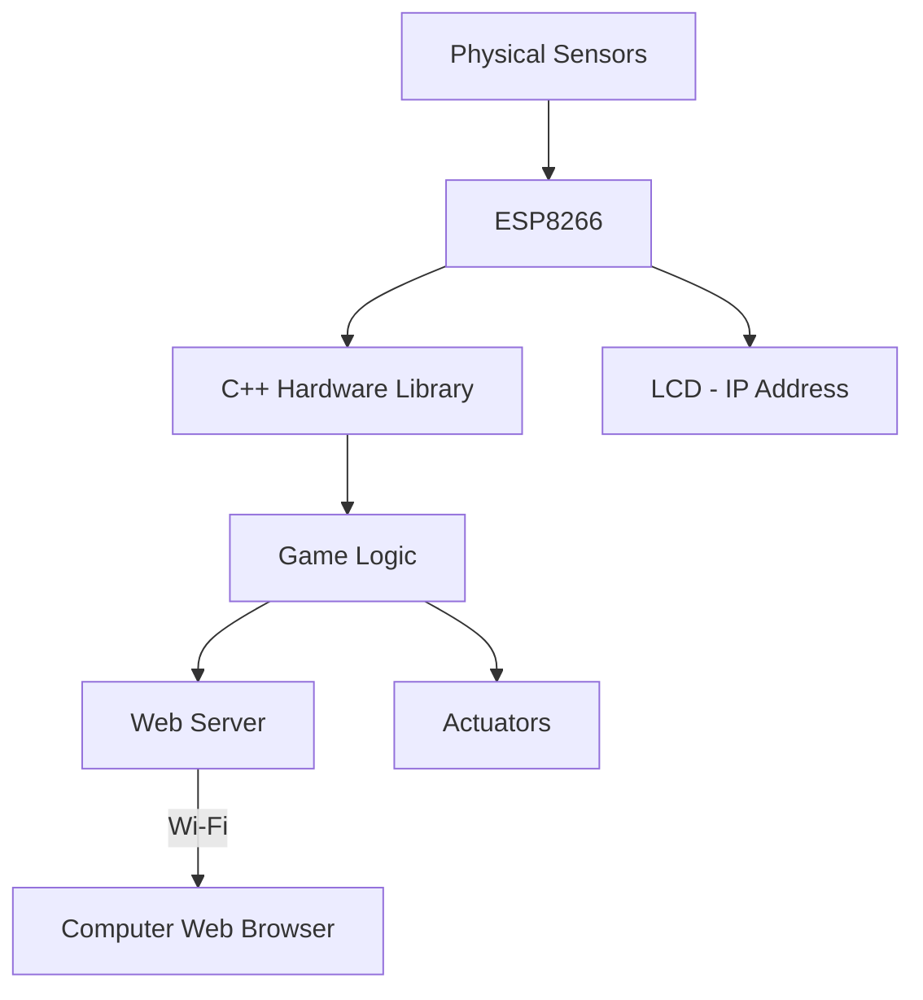
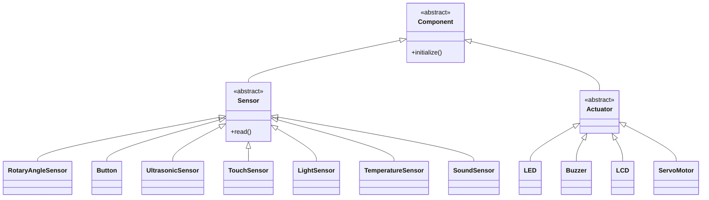
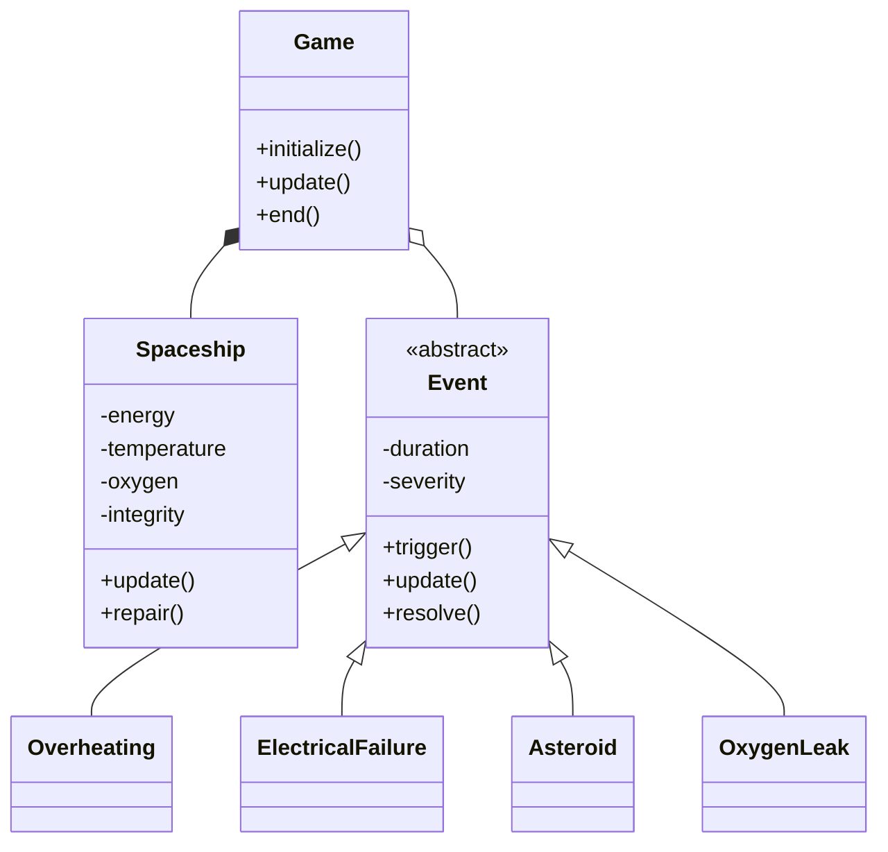

# Space Survival — C++ Project

## 1. Project Overview

Space Survival is an interactive spaceship survival game
using sensors and actuators connected to an ESP8266
microcontroller.

The player takes control of a spaceship and must keep its
different systems operational while dealing with random
critical events.

The player interacts with physical components, while the
game interface is displayed in a web browser on a computer.

## 2. Project Objectives

- Develop a modular and extensible C++ library.
- Implement and control various sensors and actuators.
- Apply object-oriented programming principles.
- Establish Wi-Fi communication with a computer.
- Develop an interactive hardware-based application.

The main focus is on C++ programming and hardware integration.
The graphical interface is intentionally kept simple.

## 3. Game Mechanics

The spaceship has four main parameters:

- Energy
- Reactor temperature
- Oxygen level
- Hull integrity

Random incidents occur throughout the mission.

The player must react by interacting with the available
sensors and physical controls.

**Main objective:** survive for 5 minutes.

### Game Over Conditions

- Energy reaches zero.
- Hull integrity reaches zero.
- Oxygen level reaches zero.
- Reactor temperature remains critically high.

## 4. Gameplay Scenarios

| Event | Player Action | Result |
|---|---|---|
| Reactor overheating | Adjust the rotary angle sensor | Reduce reactor power and virtual temperature |
| Electrical failure | Press the button | Repair the electrical system |
| Incoming asteroid | Move a hand towards the ultrasonic sensor | Trigger an avoidance maneuver |
| Oxygen leak | Activate the touch sensor | Close the airlock |
| Low battery | Shine light on the light sensor | Recharge the battery |
| Reactor overheating | Cool down the temperature sensor | Activate the cooling system |
| Communication failure | Clap near the sound sensor | Send an emergency signal |

Additional scenarios will be implemented progressively,
depending on available time and hardware constraints.

## 5. Hardware

### Main Components

- ESP8266 microcontroller
- Grove Shield
- USB cable
- Grove connection cables

### Sensors

| Component | Purpose | Priority |
|---|---|---|
| Rotary angle sensor | Reactor power regulation | P0 |
| Button | System repair | P0 |
| Ultrasonic sensor | Asteroid avoidance | P1 |
| Touch sensor | Airlock control | P1 |
| Light sensor | Solar energy generation | P2 |
| Temperature sensor | Cooling system | P2 |
| Sound sensor | Emergency communication | P2 |

### Actuators

| Component | Purpose | Priority |
|---|---|---|
| RGB LCD | Display IP address and system information | P0 |
| LED | Warning indicator | P0 |
| Buzzer | Emergency alarm | P0 |
| Servo motor | Physical airlock control | P2 |

## 6. System Architecture

### ESP8266 Responsibilities

- Read sensor values.
- Process hardware inputs.
- Manage game logic.
- Control actuators.
- Host the web server.
- Transmit the game state.

### Computer Responsibilities

- Display the game interface.
- Display spaceship statistics.
- Display warnings and ongoing events.

The computer is primarily used for visualization.
The core application runs on the ESP8266.

## 7. Wi-Fi Communication

At startup, the ESP8266 either creates its own Wi-Fi
access point or connects to an existing network.

The IP address of the microcontroller is displayed
on the LCD screen.

Example:

    IP ADDRESS
    192.168.4.1

The player connects their computer to the same network
and enters the displayed IP address into a web browser.

The web server periodically provides updated game data.

### Technologies

- C++: hardware library and game logic.
- HTML: interface structure.
- CSS: interface appearance.
- JavaScript: retrieval and display of game data.

The game logic must remain implemented in C++.

## 8. Object-Oriented Architecture

### 8.1 Hardware Library

The hardware library must be modular and reusable.

New sensors and actuators should be added without
requiring major changes to the existing application.

### 8.2 Game Logic

These class diagrams represent the initial architecture
and may evolve throughout the development process.

## 9. C++ Programming Requirements

| Concept | Application |
|---|---|
| Classes | Sensors, actuators, spaceship and events |
| Encapsulation | Protection of internal attributes |
| Inheritance | Different types of components and events |
| Abstract classes | Sensor, Actuator and Event |
| Polymorphism | Generic component and event management |
| Operator overloading | Comparison of event severity |
| STL | Storage of events using std::vector |
| Exceptions | Invalid values and initialization errors |

## 10. Development Priorities

### P0 — Minimum Viable Product

The objective is to obtain a fully functional game
with a limited number of hardware components.

#### Hardware and Communication

- [ ] Configure the ESP8266.
- [ ] Test the basic hardware components.
- [ ] Establish Wi-Fi communication.
- [ ] Display the IP address on the LCD.
- [ ] Implement a basic web server.
- [ ] Display sensor values in the browser.

#### C++ Hardware Library

- [ ] Implement the Component abstract class.
- [ ] Implement the Sensor abstract class.
- [ ] Implement the Actuator abstract class.
- [ ] Implement the RotaryAngleSensor class.
- [ ] Implement the Button class.
- [ ] Implement the LCD class.
- [ ] Implement the LED class.
- [ ] Implement the Buzzer class.

#### Game Logic

- [ ] Implement the Spaceship class.
- [ ] Implement the Game class.
- [ ] Implement the Event abstract class.
- [ ] Implement reactor overheating.
- [ ] Implement electrical failure.
- [ ] Implement victory and defeat conditions.
- [ ] Integrate hardware and game logic.
- [ ] Test the complete system.

### P1 — Additional Features

- [ ] Implement the UltrasonicSensor class.
- [ ] Implement the TouchSensor class.
- [ ] Add asteroid events.
- [ ] Add oxygen leak events.
- [ ] Improve warning messages.
- [ ] Improve alarm management.

### P2 — Optional Features

- [ ] Implement the ServoMotor class.
- [ ] Implement the LightSensor class.
- [ ] Implement the TemperatureSensor class.
- [ ] Implement the SoundSensor class.
- [ ] Add solar energy generation.
- [ ] Add physical airlock control.
- [ ] Add additional random events.
- [ ] Improve the graphical interface.

Optional features will only be implemented once the
minimum viable product is fully operational.

## 11. Collaborative Project Planning

Task management, priorities, responsibilities and
development progress are available in our shared
Google Sheets document.

[Space Survival - Project Planning](INSERT_LINK_HERE)

## 12. Technical Constraints

- The ESP8266 has only one analog input.
- Check the 3.3 V compatibility of all components.
- Check the available Grove Shield ports.
- Use millis() instead of blocking delay() calls.
- Avoid blocking the web server.
- Verify C++ exception support.
- Test each component individually before integration.
- Do not publish private Wi-Fi credentials on GitHub.
- Prioritize functionality over graphical complexity.

## 13. Installation and Usage

This section will be completed during development.

### Prerequisites

- Arduino IDE
- ESP8266 board support
- Required Grove libraries
- Web browser

### Compilation

To be completed.

### Hardware Connections

To be completed.

### Running the Game

1. Upload the program to the ESP8266.
2. Connect the computer to the appropriate Wi-Fi network.
3. Read the IP address displayed on the LCD.
4. Enter the IP address in a web browser.
5. Start the mission.
6. Interact with the physical components to keep
   the spaceship operational.

## 14. Project Deliverables

- [ ] Complete and commented source code.
- [ ] Modular C++ hardware library.
- [ ] Functional interactive application.
- [ ] README with installation and usage instructions.
- [ ] Design report (maximum 3 pages).
- [ ] Class diagrams.
- [ ] Sequence diagrams.
- [ ] Hardware connection diagram.
- [ ] Final project demonstration.

---

## Project Information

**Project:** Space Survival

**Institution:** INSA Toulouse

**Course:** Object-Oriented Programming in C++

**Department:** Electrical and Computer Engineering (4AE)

**Team:** To be completed

**Status:** Under development
